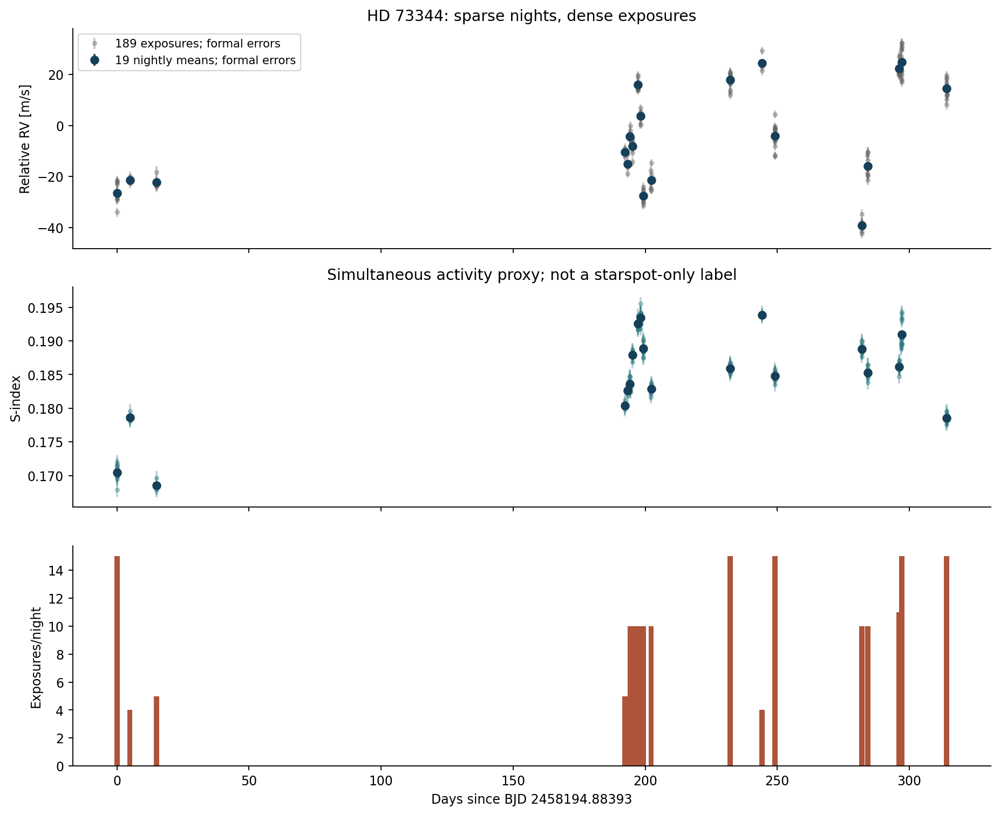
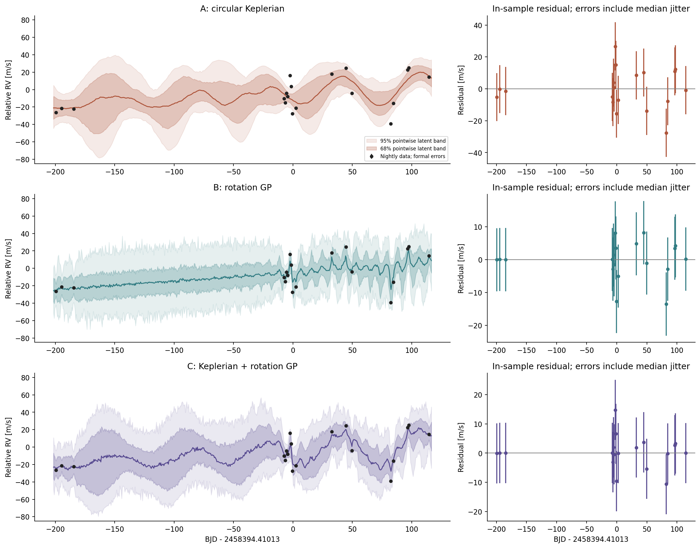
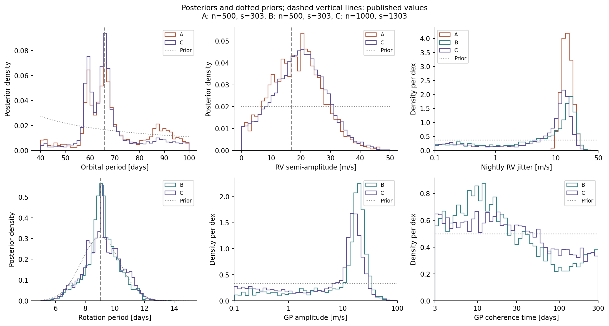

# PHANTOM-PLANET P03 — HD 73344 model comparison

**Recommendation for P04: DROP the proposed new planet-detection product.**
This phase does not demonstrate a scientific advantage over established RV/GP
methods. The small Keck subset supports only a conditional, inconclusive
comparison. It neither discovers a planet nor disputes the published system.
Preserve this work as a reproducible research exercise; do not manufacture a
feature to justify continuing.

Analysis date: 2026-10-17. Review branch:
`research/p03-hd73344-model-comparison`, based on PR #1's P01 head
`e4d0eaca52c7b57d92c40c09f942d67f38311fe5`. P01 Python source and its four tests
are unchanged. PR #1 was reviewed read-only and remains unmerged.

## Measurements and scope

Imported the unmodified public [KOA K2 RV/activity release](https://koa.ipac.caltech.edu/Datasets/K2ExoDiversity/K2_RV_Activity.php)
(2332 measurements, 84 stars; DOI 10.26135/KOA5) and all six supplied P02 audit
artifacts. The archive CSV and JSON were cross-matched by star/exposure ID.
HD 73344 = EPIC 212178066 has **189 exposures across 314.189998 days**. Its raw
RV standard deviation is 20.0596 m/s and median formal error 1.7266 m/s, matching
P02. No target measurement was clipped or imputed.

Correct Hawaiian-night grouping, `floor(BJD - 0.5)`, gives **19 nights**; the
longest spans 5.37 hours. Only three precede an approximately 177-day gap. An
earlier `floor(BJD)` partition both split and merged physical nights; those runs
were stopped before producing evidence and are explicitly archived as invalid.
One nonpositive S-index uncertainty on an unrelated archive star is counted;
all target uncertainties are positive.

This release is not the full 238-exposure HIRES reduction used in the literature.
We fit nightly means with propagated formal errors plus a free nightly jitter;
this approximates unresolved short-term noise. S-index observations are diagnostic,
not activity-only labels or an additional response in the RV evidence.

## Models and fair comparison

- **A:** one circular Keplerian, testing the reported roughly 66-day companion.
- **B:** stellar variability represented by a quasi-periodic rotation GP.
- **C:** the same Keplerian plus the same GP, fitted jointly.
- **N:** offset, linear trend and jitter reference.

Every model has identical offset/trend/jitter priors. A/C share identical orbital
priors; B/C share identical GP priors. All use the same 19 RVs, units and fully
normalized Gaussian likelihood. No detrended or prewhitened RVs are compared
against raw data. Proper finite priors, the kernel equation and all restrictions
are specified in [METHODS.md](METHODS.md).

The primary orbital period prior is log-uniform over 40–100 days, explicitly a
retrospective literature-conditioned question. The rotation prior is a broad
truncated normal based on independent later TESS photometry. This is not a blind
planet search. Circular c, a local trend for long-period effects, and nightly
jitter are restrictive assumptions; b, a full orbit for d, eccentricity and a
short-term GP are not estimated.

## Evidence results

Natural logarithms of evidence; quoted errors are sampler Monte Carlo estimates,
not astrophysical systematic uncertainty. Runs are independent. C's preferred
results use the higher resolution selected after the initial posterior-shape
diagnostic failed.

| Model | Live points | Seed(s) | ln Z, first run | ln Z, second run |
|---|---:|---|---:|---:|
| A — Keplerian | 500 | 303, 73344 | -87.107 +/- 0.147 | -86.787 +/- 0.149 |
| B — activity GP | 500 | 303, 73344 | -86.911 +/- 0.116 | -86.765 +/- 0.114 |
| C — both | 1000 | 1303, 2303 | -86.194 +/- 0.101 | -86.216 +/- 0.106 |
| N — offset/trend/jitter | 500 | 303, 73344 | -87.816 +/- 0.121 | -87.619 +/- 0.119 |

**A and B are indistinguishable here.** B minus A is 0.196 +/- 0.187 nats in
seed 303 and 0.022 +/- 0.188 in seed 73344. C's primary advantage over B is only
about 0.55–0.72 nats (Bayes factors about 1.7–2.1), and over A about 0.57–0.91
nats. C versus N is only about 1.40–1.62 nats. These conditional ratios do not
justify selecting a physical origin or reporting an unconditional planet probability.

Prior stress tests reinforce that caution:

| Variant, seed 303 | A ln Z | B ln Z | C ln Z | C minus B |
|---|---:|---:|---:|---:|
| Broad P=2–150 d, Prot=2–100 d | -88.171 | -87.418 | -87.225 | +0.193 |
| K/jitter upper bounds doubled | -87.836 | -87.100 | -87.098 | +0.002 |

The broader-prior second C run gives ln Z=-87.690 +/-0.139, and its posterior
shape comparison fails the specified diagnostic. Thus this stress test is
exploratory and cannot support precision estimates or a reliable fine ranking.
The amplitude variant has one seed and is also a limited sensitivity check.
No evidence values from different prior variants are combined into a Bayes factor.
All 19 target runs, including the lower-resolution checks, are retained in
[model_comparison.csv](model_comparison.csv) and [all_run_summaries.json](all_run_summaries.json).

## Convergence and diagnostics

Static dynesty 2.1.5 used multi-ellipsoid bounds, random walks, 30 walk steps,
and dlogz=0.05, without a call/iteration cap. Weighted ESS ranges from about
2330 to 10784. Weight ESS is not a count of independent MCMC draws; R-hat is
not applied to nested samples.

A/B/N independent seeds pass the declared evidence and marginal-shape diagnostic.
C's two 500-live runs had stable evidence but failed nuisance-shape checks.
Two independent **1000-live** runs pass both checks; their evidences differ by
0.0223 nats, about 0.153 combined sampler sigma. Earlier failure flags remain
in [convergence_and_comparisons.json](convergence_and_comparisons.json), rather
than being erased. Agreement cannot prove that every mode was found. The wide
prior C failure remains unresolved and limits that stress test.

In-sample residual RMS is 12.20 m/s (A), 5.59 (B), and 5.36 (C), from the plotted
posterior conditional medians. GP conditioning naturally reduces these residuals.
The 95% in-sample predictive intervals cover all 19 data points; this is **not**
independent predictive validation. There is no held-out-star, injection-recovery,
false-positive-rate or completeness result.

## Consistency with published HD 73344 work

The preferred C run (seed 1303) gives a broad period summary of 65.28 days
(68% equal-tail interval 58.65–75.64) and K=19.75 m/s (10.22–28.30).
The distribution has multiple period modes, including structure near 60, 66
and longer periods; its median is not a unique orbital solution. Its rotation
summary, 9.15 days (8.07–10.46), largely reflects the prior. GP amplitude,
coherence and jitter remain weakly separated. A nonnegative K prior means a
positive lower quantile is not itself evidence of a planet.

[Sulis et al. (2024)](https://arxiv.org/abs/2405.17155) already studied this active
host with photometry, SOPHIE/HIRES and two GPs. [Zhang et al. (2025)](https://arxiv.org/abs/2408.09614)
used a much longer multi-instrument/astrometric baseline, reporting c at
65.936 days with K=16.83 m/s and TESS rotation near 9.03 days. Our broad summaries
include those values, but provide neither their precision nor independent confirmation.
The roughly 15.61-day transiting b and roughly 5746-day outer d are established
literature context, not newly fitted discoveries here. Shared HIRES observations
also prevent treating this check as independent replication.

## Juliet example: executed, with explicit replication limits

Installed juliet 2.2.10 and ran the official [TOI-141 RV example](https://juliet.readthedocs.io/en/latest/tutorials/rvfits.html)
using its original data and priors, with dynesty replacing the older documented
default sampler. The first example completed and its likelihood was independently
checked before target sampling; the two-planet extension ran concurrently.

| Tutorial model | This juliet run ln Z | Documentation figure ln Z |
|---|---:|---:|
| One planet | -803.861 +/-0.358 | -805.302 +/-0.027 |
| Two planets | -691.130 +/-0.452 | -690.892 +/-0.023 |

Delta ln Z=112.731 versus the documented approximately 114.4: the strong
two-planet preference is recovered. **Exact historical numeric replication is
not achieved.** The one-planet evidence differs by 1.442 nats, beyond the quoted
errors. Current juliet's P2=4.78517 days differs from the historical plotted
posterior near 4.760 days. Input bytes match the documentation build commit, so
data drift does not explain this. The cause is unresolved.

Both saved likelihoods agree with separate Gaussian/sine calculations at 50
points each, including juliet's increasing-period rejection rule. A separate
analytic-evidence test gives -3.0131 +/-0.0670 versus exact -2.9957. These validate
normalization and implementation locally; they do not turn the historical
discrepancies into successful exact replication. Additional direct-reference
attempts and outputs are retained with the work log and tutorial JSONs.
In particular, a separate ordered 500-live random-walk reference found
P2=4.75975 days but ln Z=-695.187 +/-0.338, substantially different from the
current juliet fit. Matching the historical period mode therefore does not
establish a converged evidence reproduction. The independent one-planet result,
-804.467 +/-0.258, agrees with the current one-planet juliet run within about
1.4 combined sampler sigma. The two-planet extension remains a distinct
global-exploration limitation, and is not used to claim target validation.
A 2000-live uniform-ellipsoid reference attempt was stopped after 845.8 seconds
when dynesty warned that ellipsoid sampling was extremely inefficient. It did
not produce a completed evidence estimate. Its [aborted status](tutorial_direct_global_status.json)
and warning are retained; no value is substituted for that missing result.

## Scientific opportunity and P04 decision

Planet/activity GP separation and benchmarking already exist, including
[Rajpaul et al. (2015)](https://doi.org/10.1093/mnras/stv1428) and the
[RV fitting challenge](https://doi.org/10.1051/0004-6361/201628671). This target
has already received richer analyses. We have demonstrated no new algorithm,
no improvement on an established baseline, and no independent validation set.
Insufficient data and prior sensitivity are established difficulties, not a
new product justification.

**P04: DROP.** Archive this scoped feasibility result for reuse and learning.
Reopening a research direction would require a specific, falsifiable failure
of existing methods and independent evidence that a proposed method improves it.
That is a condition for reconsideration, not a proposed extra feature or a GO.
This conclusion is limited to the opportunity demonstrated by this phase;
it is not proof that all future stellar-noise research is exhausted.

## Reproducible artifacts

- [Methods and every prior](METHODS.md), [scientific limitations](SCIENTIFIC_VALIDATION.md), [attempt log](WORK_LOG.md).
- [Data audit and hashes](data_audit.json), [environment](environment.json), [input URLs](input_sources.jsonl).
- [Posterior samples](posteriors/), [evidence differences](evidence_differences.csv), [diagnostic metrics](predictive_diagnostics.json).
- Figures below are PNG previews; matching PDF files are available in figures/.
- Thirteen pytest tests pass; P01's separate four-test unittest workflow also passes.
  New P03 code passes Ruff and Python compilation. No remote CI success is claimed.

